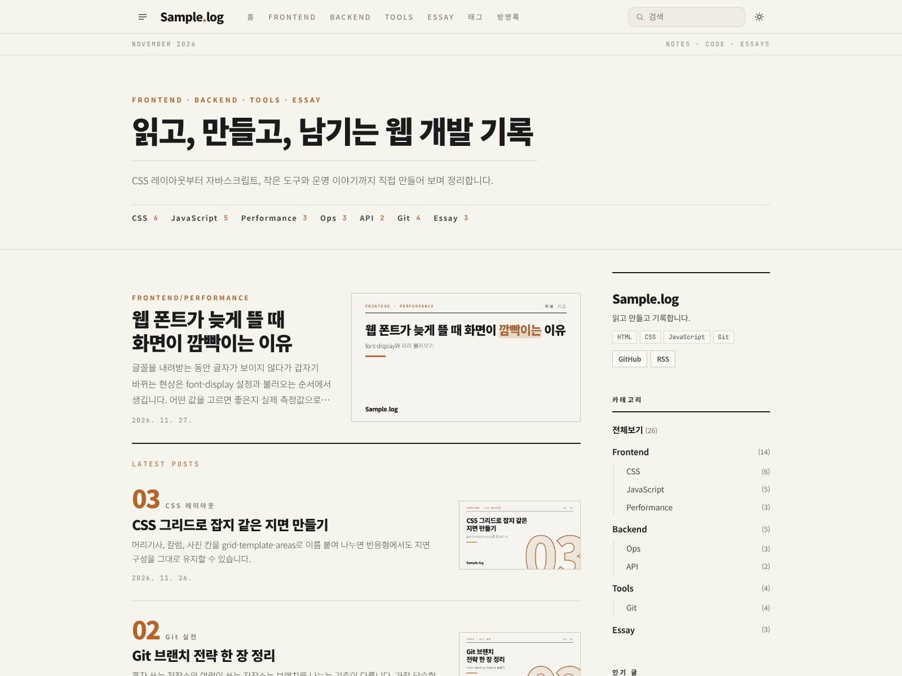

# Colophon

**선으로 나눈 지면, 큰 회차 숫자, 굵은 본고딕.** 긴 기술 글과 연재 글을 위한 티스토리 에디토리얼 스킨입니다.

> Colophon is an editorial Tistory skin for long technical posts and series: ruled pages, large issue numbers and bold Noto Sans KR. Light (paper) by default, with a dark mode.



실제 사용 예: [Gwanghwa.log](https://blog.gwanghwa.net)

## 특징

- **에디토리얼 지면**: 둥근 카드 대신 굵은 윗선과 가는 줄로 나눈 목록·사이드바·글 아래 영역
- **연재 회차 숫자**: 글 제목이 `… — 연재명 ④`처럼 끝나면 목록과 글 머리에 큰 회차 숫자(04)를 그립니다
- **라이트(미색 지면)·다크** 두 테마, 방문자가 헤더 버튼으로 전환 (선택은 브라우저에 기억)
- **코드 블록**: 언어 표시·복사 버튼, 티스토리 기본 하이라이트와 어울리는 색, 실행 결과(`plaintext`) 구분
- **자동 목차**(넓은 화면은 오른쪽 고정, 좁은 화면은 접이식), 읽기 진행 바, 표 가로 스크롤
- **인용문**: 티스토리 기본 인용 스타일 1·2·3을 모두 같은 지면 스타일로 정리
- **호수 띠**: 헤더 아래 `NOVEMBER 2026 · {문구}` 띠 (월·연도는 방문 날짜 기준으로 자동)
- 글꼴: Noto Sans KR, JetBrains Mono (Google Fonts)

## 설치

1. [Releases](../../releases)에서 `colophon-x.y.z.zip`을 받습니다.
2. 티스토리 **관리 → 꾸미기 → 스킨 변경 → 스킨 등록**에서 zip을 올리고 적용합니다.
3. **스킨 편집**에서 아래 옵션을 채웁니다.

> ⚠️ 티스토리는 스킨을 **다시 올리면 스킨 편집 옵션을 지웁니다** (글 옵션은 빈칸, 선택 옵션은 첫 항목). 자주 고쳐 올린다면 아래 [프리셋](#프리셋으로-내-블로그-판-만들기)으로 내 값을 스킨에 넣어 두세요.

## 스킨 옵션

| 옵션 | 설명 |
|---|---|
| 기본 테마 | 방문자가 고르기 전 테마. 라이트 / 다크 / 시스템 설정 따름 (첫 항목 라이트가 기본) |
| 로고 이미지 | 비우면 블로그 이름이 글자 로고로 나오고, 이름 끝부분의 마지막 `.`만 강조색 (예: `Blog.log`) |
| 소개 윗줄 · 소개 제목 · 소개 설명 | 홈 첫 화면 소개. 비우면 그 줄을 숨김 |
| 한 줄 소개 | 사이드바 프로필과 글 아래 작성자 상자 |
| 기술 스택 | 쉼표로 구분, 칩으로 표시. 비우면 숨김 |
| GitHub 주소 · 연락 이메일 | 비우면 표시하지 않음 |
| 푸터 문구 · 저작권 시작 연도 | 푸터 `문구` + `© 시작–올해 블로그 이름` |
| 호수 띠 문구 | 헤더 아래 띠 오른쪽 문구. 비우면 월·연도만 |
| 자동 목차 · 읽기 진행 바 · 빈 카테고리 숨김 | 켜기/끄기 |
| 강조 색상 | 쓰이지 않음 (테마별 강조색은 `style.css`의 `--ed-accent`) |

## 글 쓰는 규칙 (스킨이 알아보는 것)

- **연재 글 제목**: `제목 — 연재명 ①` ~ `⑳` (긴 줄표 `—` 앞뒤 공백, 동그라미 숫자). 예: `자바 기본 자료형과 형 변환 — 자바 기초 ④`
- **코드 블록**: 에디터에서 언어를 고르거나 `<pre class="language-java"><code>…</code></pre>`처럼 지정. 실행 결과·다이어그램은 `language-plaintext`
- **소제목**: 제목1(h2)·제목2(h3)를 쓰면 자동 목차에 들어가고, h2에는 `01`, `02` 번호가 붙습니다

## 프리셋으로 내 블로그 판 만들기

옵션이 비어 있을 때 대신 보일 값을 스킨에 넣어 빌드할 수 있습니다. 다시 올려도 소개·프로필·푸터가 유지됩니다.

```bash
cp presets/example.json presets/my-blog.json   # 값을 내 블로그에 맞게 고침
python3 tools/build.py --preset presets/my-blog.json --out my-blog-colophon.zip
```

- 기본판: `python3 tools/build.py` → `dist/colophon-{버전}.zip` (옵션 기본값이 모두 비어 있음)
- 프리셋 키: `heroKicker`, `heroTitle`, `heroDesc`, `profileDesc`, `techStack`, `githubUrl`, `contactEmail`, `footerText`, `copyrightStart`, `mastheadText`, `defaultTheme`
- 스킨 편집에 값을 넣으면 그 값이 프리셋보다 먼저 쓰입니다.
- 개인 정보가 든 프리셋은 공개 저장소에 올리지 마세요.

## 문의·제안

버그 제보와 기능 제안은 [Issues](../../issues)로 받습니다. 풀 리퀘스트(코드 기여)는 받지 않으니, 고치고 싶은 점이 있으면 이슈로 남겨 주세요.

## 폴더 구조

```text
skin/          스킨 원본 (skin.html, style.css, index.xml, images/script.js, 미리보기 이미지)
presets/       프리셋 예시
tools/build.py zip 빌드 (Python 3, 표준 라이브러리만)
tools/release_notes.py  CHANGELOG에서 릴리즈 노트 꺼내기
.github/workflows/release.yml  릴리즈 자동 생성 (관리자용)
```

## 라이선스

[MIT](LICENSE) © 2026 Gwanghwa.log
글꼴(Noto Sans KR, JetBrains Mono)은 SIL Open Font License로 Google Fonts에서 불러옵니다. 코드 하이라이트(highlight.js)는 티스토리가 제공합니다.
